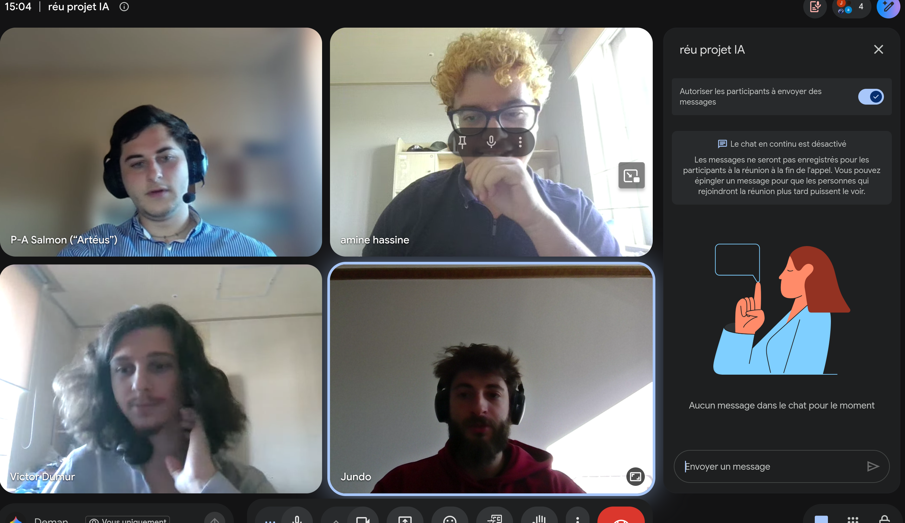

https://mylms.korea.ac.kr/courses/100436/discussion_topics/434781
https://mylms.korea.ac.kr/groups/17299/users
https://mylms.korea.ac.kr/courses/100436/discussion_topics/435136
https://mylms.korea.ac.kr/groups/17299/discussion_topics/435053
# Zoom meeting
1. All group members must attend. The group leader hosts the meeting.
2. Assign roles and make a plan for the week's tasks.
3. Post each participant's opinion from the Zoom meeting as a memo by clicking the "Reply" button. Every member must share at least one opinion.

# Zoom deliver
- Create a final Word document (one-page length in A4, format is free) summarizing your group's discussion.
- Attach a screenshot of the online ZOOM meeting to show all group members in the final Word document (second page)
- Go to [LMS]→ [People]→ [Groups]→ [reply] The final Word document

---

Le projet du coup

# PROJET

Find 3 public dataset candidates and choose 1 of them. Make a table with the source, data size (number of samples and features), and license of each candidate. Write why you chose the final one.

Example: Kaggle "Heart Disease" / 303 samples, 13 features / CC0 license / The features are clean and the data is small, so we can run many experiments.

Define the problem you will solve with the chosen data. Write the input, the target, and the problem type (binary classification, multiclass classification, or regression).

Example: Binary classification that predicts heart disease (target) from a patient's test results (input)

Choose the evaluation metric that shows success and explain why. Check the class ratio. If the classes are in imbalanced, consider metrics other than accuracy.

Example: The classes are 54:46, which is similar, so we use accuracy and ROC AUC.

Calculate the common-sense baseline. This is the score you can get without a model.

Example: Always predicting the larger class gives 54% accuracy. / For regression, the MAE whe   n always predicting the mean

Create a team notebook in Colab or Kaggle. Load the data and print the first 5 rows.

## Meeting memo — 07/11

During this meeting we:
- Went through the assignment together.
- Clarified the key notions (dataset, problem type, evaluation metric, common-sense baseline) so that everyone has the same understanding.
- Set up the project together.
- Split the tasks:
  - **Paul-Antoine and Amine** will choose the dataset and write the justification for this choice.
  - **Victor and Gianni** will choose the evaluation metric after checking the class ratio, and compute the common-sense baseline.

### Opinions

- **Paul-Antoine:** As beginners, we should pick a small, clean dataset so we can focus on understanding the basics.
- **Amine:** We should choose data with only numeric columns and no missing values, and check that its license allows us to use it.
- **Victor:** Accuracy is the simplest metric to understand, so we start with it and only add another one if needed.
- **Gianni:** The common-sense baseline gives us a minimum score to beat, so we can tell if a model is really learning.
